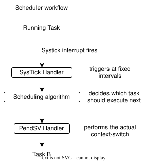

# zeroRTOS v1.2.0 - a preemptive scheduler built for ARM Cortex M0+ and M3 processors.

zeroRTOS is a Real Time Operating System kernel, with key features :
- It is a priority based preemptive scheduler.
- It is portable across ARM Cortex M0+ and M3. *(Support for Cortex M33 coming soon.)*
- It is a portable SDK - builds to a static library providing `libzeroRTOS.a`
- Task delay feature.
- Semaphores.

---

## Tech Stack

- Programming language - C, ARM Assembly
- Firmware Library - libopencm3
- cross-compiler - arm-none-eabi-gcc
- Debugging/ firmware flashing - OpenOCD(via ST-Link), GDB
- IDE - Visual Studio Code
- Development host machine - Fedora Linux 43 (KDE Plasma Desktop Edition) x86_64

### Dev boards used for development:
|       Dev Board                    |   Processor  | Processor type |
|:----------------------------------:|--------------|----------------|
|STM32 B-L072Z-LRWAN1 Discovery board|STM32L072CZYX | ARM Cortex M0+ |
|STM32 Blue Pill                     |STM32F103C8T6 |ARM Cortex M3   |

---
<br>

## Reference Material
- The Definitive Guide to ARM® Cortex®-M0 and Cortex-M0+ - Joseph Yiu - 2nd edition
- ARM® v6-M Architecture Reference Manual
- Reference Manual for STM32L0x2 - [pdf](https://www.st.com/resource/en/reference_manual/rm0376-ultralowpower-stm32l0x2-advanced-armbased-32bit-mcus-stmicroelectronics.pdf)
- User Manual for STM32L0 - UM2115
- Reference Manual for STM32F1 - [pdf](https://www.st.com/resource/en/reference_manual/rm0008-stm32f101xx-stm32f102xx-stm32f103xx-stm32f105xx-and-stm32f107xx-advanced-armbased-32bit-mcus-stmicroelectronics.pdf)

---

## Installation and running

**Disclaimer:** This project was developed and tested exclusively on **Fedora Linux**. All commands, installation procedures, and debugging workflows below are **Linux-specific**. If you are on Windows or macOS, using WSL2 or a Linux VM is recommended.

The project assumes you are using flashing/debugging via ST-Link.

### Pre-requisites
- `make`
- `arm-none-eabi-gcc`
- `openocd`
- `arm-none-eabi-gdb` (optional, for debugging)

<br>

**Installation command:**
Fedora:
```bash
sudo dnf install make arm-none-eabi-gcc openocd arm-none-eabi-gdb -y
```

**Change your project directory to trusted list**
```bash
# Run this from the root of the zeroRTOS repository
echo "add-auto-load-safe-path $(pwd)" >> ~/.gdbinit
```
<br>

### Usage
Running `make` in this repo gives a static library file `libzeroRTOS.a` in lib/armvx-m

**Recommended**
Use this repository as a submodule in your main application folder by running:
```bash
# 1. Add the main submodule in your application folder
git submodule add https://github.com/syedfardin83/zeroRTOS.git

# 2. Initialize and clone all nested submodules recursively
git submodule update --init --recursive
```
Use the Makefile given in the examples folder.

**Important note:**
In the main code, the `zrtos_init()` function is to be used, to initialize zeroRTOS. From this point, the Microcontroller is under the control of zeroRTOS. After initializations, new tasks can be created using the `zrtos_create_task()` function. To start the execution of the tasks, use the `zrtos_tasks_start()` function. **Any code after this function call will never be executed**.


<br>

---

## Architecture
<p align="center">
    
</p>

### The SysTick Timer
zeroRTOS v1.2.0 is a priority based preemptive scheduler. The SysTick timer is configured by default under `zrtos_init()` function with SysTick frequency of **1kHz**. 
So, every 1ms, the SysTick exception is taken. The next task to be executed is determined in this handler, and the `PENDSVSET` bit in the ICSR (Interrupt Control and State Register) is set, signalling the NVIC(Nested Vectored Interrupt Controller) that the PendSV exception must be executed.

### The PendSV Handler
This is the exception where the actual context switching takes place. This is an exception configured with the lowest priority, so that context switching does not take place when there is an important exception handler is already being executed. 

### The Context Switching Mechanism
**ARM Cortex-M0+ processors:**
When any exception is taken by the processor, an in-built mechanism pushes the `xPSR`, `PC`, `LR`, `R12`, `R3`,`R2`,`R1` and `R0` register (in the same order) to the running task's stack automatically.
The PendSV handler pushes the rest of the general purpose registers - `R4` to `R11` to the current task's stack, and loads the register values (`r4-r11`) from the next task's stack into the processor's general purpose registers. Because the ARMv6-M architecture cannot push high registers (r8-r11) in a single instruction, the handler stages them through r4-r7 before pushing. The PSP value is then changed to the new task's `topOfStack` value, which is taken from the new task's TCB, effectively changing the running task.

**ARM Cortex-M3 processors:**
The exception entry mechanism is the same as on Cortex-M0+: the processor automatically pushes `xPSR`, `PC`, `LR`, `R12`, `R3`, `R2`, `R1` and `R0` onto the running task's stack.
The PendSV handler saves the remaining registers, `R4` to `R11`, onto the current task's stack and restores `R4` to `R11` from the next task's stack. Unlike ARMv6-M, the Thumb-2 instruction set of ARMv7-M can store and load the high registers directly,  with no staging through low registers.
The handler reads the current task's stack pointer from `PSP`, pushes the registers, and saves the updated stack pointer into the current TCB's `topOfStack`. It then loads the next task's `topOfStack` from its TCB, pops `R4`-`R11` from that stack, writes the new value back to `PSP`, and returns using the `EXC_RETURN` value that selects thread mode with the process stack. The hardware then pops the remaining registers from the new task's stack, and the new task resumes exactly where it was interrupted.
