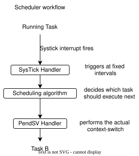

### zeroRTOS - a preemptive scheduler built for ARM Cortex M0+ architecture.

zeroRTOS is a preemptive scheduler built for ARM Cortex M0+ architecture, and specifically the *STM32L072CZYX* microcontroller, though it might work on other microcontrollers with the same architecture.

---

## Tech Stack
- Microcontroller - STM32L072CZYX - ARM Cortex-M0+ - ARMv6-M architecture
- Development Board - STM32 B-L072Z-LRWAN1
- Programming language - C, ARM Assembly
- Firmware Library - libopencm3
- cross-complier - arm-none-eabi-gcc
- Debugging/ firmware flashing - OpenOCD(via ST-Link), GDB
- IDE - Visual Studio Code
- Development host machine - Fedora Linux 43 (KDE Plasma Desktop Edition) x86_64

---

## Reference Material
- The Definitive Guide to ARM® Cortex®-M0 and Cortex-M0+ - Joseph Yiu - 2nd edition
- ARM® v6-M Architecture Reference Manual
- Reference Manual for STM32L0x2 - [pdf](https://www.st.com/resource/en/reference_manual/rm0376-ultralowpower-stm32l0x2-advanced-armbased-32bit-mcus-stmicroelectronics.pdf)
- User Manual for STM32L0 - UM2115

---

## Installation and running

**Disclaimer:** This project was developed and tested exclusively on **Fedora Linux**. All commands, installation procedures, and debugging workflows below are **Linux-specific**. If you are on Windows or macOS, we recommend using WSL2 or a Linux VM.

The project assumes you are using a stm32l072czyx microcontroller, and flashing/debugging via ST-Link.

### Pre-requisites
- `make`
- `arm-none-eabi-gcc`
- `openocd`
- `arm-none-eabi-gdb` (optional, for debugging)

<br>

**Installation command:**
Fedora:
```bash
sudo dnf install make arm-none-eabi-gcc openocd arm-none-eabi-gdb -y
```

**Change your project directory to trusted list**
```bash
# Run this from the root of the zeroRTOS repository
echo "add-auto-load-safe-path $(pwd)" >> ~/.gdbinit
```
<br>

### Usage
Application code should be written in `src/main.c`
There is an example code in it as a default.

**Firmware binary**
The final flashable firmware is produced as `firmware.elf` by default. You can change this binary name by changing the `BINARY` value in `src/Makefile`

Along with the binary, `.elf` `.hex` `.map` are also produced by default, under the same name as `BINARY` Makefile variable, for the firmware.

**Adding new files**
Every new source file added must be added in `src/Makefile` under `OBJS` Makefile variable as a `.o` file, to make it known to the compiler of a new object file it has to produce.

**Important note:**
In the main code, the `zrtos_init()` function is to be used, to initialize zeroRTOS. From this point, the Microcontroller is under the control of zeroRTOS. After initializations, new tasks can be created using the `zrtos_create_task()` function. **The tasks will be executed in the order that they are added**. To start the execution of the tasks, use the `zrtos_tasks_start()` function. **Any code after this function call will never be executed**.


<br>

### Building the firmware binary
```bash
make
```

<br>

### Flashing the firmware binary
```bash
openocd -f interface/stlink.cfg -f target/stm32l0.cfg -c program firmware.elf verify reset exit
```

---

## Architecture
<p align="center">
  <kbd style="background-color: #ffffff; display: inline-block; padding: 16px; border-radius: 8px;">
    
  </kbd>
</p>

### The SysTick Timer
zeroRTOS v1.0.0 is a preemptive round-robin scheduler. The SysTick timer is configured by default under `zrtos_init()` function with clock frequency of **32MHz**, and SysTick frequency of **1kHz**. 
So, every 1ms, the SysTick exception is taken. The next task to be executed is determined in this handler, and the PendSV bit in the ICSR (Interrupt Control and State Register) is set, signalling the NVIC(Nested Vectored Interrupt Controller) that the PendSV exception must be excecuted.

### The PendSV Handler
This is the exception where the actual context switching takes place. This is an exception configured with the lowest priority, so that context switching does not take place when there is an important exception handler is already being excecuted. 

### The Context Switching Mechanism
**Note: This mechanism is specifically for the ARM Cortex-M0+ processors.**
When any exception is taken by the processor, an in-built mechanism pushes the `xPSR`, `PC`, `LR`, `R12`, `R3`,`R2`,`R1` and `R0` register (in the same order) to the running task's stack automatically.
The PendSV handler pushes the rest of the general purpose registers - `R4` to `R11` to the current task's stack, and loads the register values from the next task's stack into the processor's general purpose regsiters. Because the ARMv6-M architecture cannot push high registers (r8-r11) in a single instruction, the handler stages them through r4-r7 before pushing. The PSP value is then changed to the new task's `topOfStack` value, which is taken from the new task's TCB, effectively changing the running task. 
